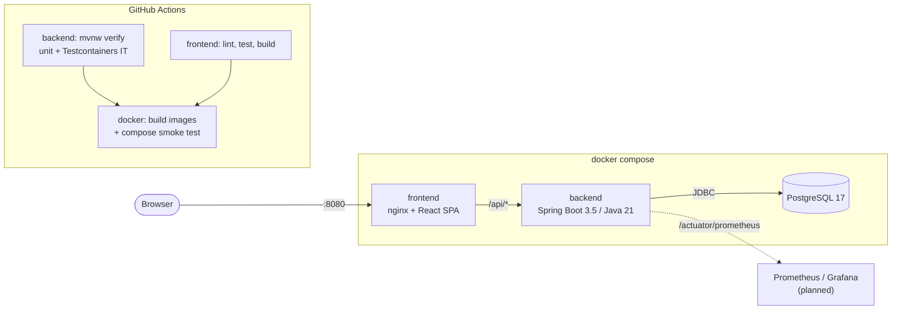

# TaskFlow

[](https://github.com/Neeraj95464/taskflow/actions/workflows/ci.yml)


[](LICENSE)

**A small team task board built the way production services are built: a Spring Boot REST API, a React + TypeScript UI, PostgreSQL with Flyway, real-database integration tests with Testcontainers, Docker images and a GitHub Actions pipeline that builds, tests and smoke-tests the whole stack.**

> **Status — work in progress**
> - Developed with **AI-assisted development** (Claude Code); design, review and testing by me.
> - Backend unit/web tests and frontend lint, tests and build pass locally.
> - **End-to-end testing is pending:** Testcontainers integration tests, Docker image builds and the full `docker compose` stack run are verified only through CI.

## Architecture



## Features

- **Projects and tasks** with full CRUD; tasks have title, description, status (`TODO` / `IN_PROGRESS` / `DONE`), priority, due date and audit timestamps.
- **Board UI** with three columns, a create-task form, one-click status moves and a project filter.
- **Filtering and pagination** on `GET /api/tasks?projectId=&status=&page=&size=&sort=`.
- **Consistent errors** as RFC 7807 `application/problem+json`, including per-field validation messages.
- **Schema as code** with Flyway migrations; Hibernate only validates the schema.
- **Operability**: Actuator health (liveness and readiness probes), Prometheus metrics, OpenAPI docs with Swagger UI, graceful shutdown.
- **Container-ready**: multi-stage Dockerfiles, layered Spring Boot jar, non-root users, health checks.

## Tech stack

| Layer      | Technology |
|------------|------------|
| Backend    | Java 21, Spring Boot 3.5 (Web, Data JPA, Validation, Actuator), Flyway, springdoc-openapi, Micrometer + Prometheus |
| Database   | PostgreSQL 17 |
| Frontend   | React 19, TypeScript, Vite, plain CSS |
| Testing    | JUnit 5, Mockito, AssertJ, MockMvc (`@WebMvcTest`), Testcontainers, Vitest, Testing Library |
| Delivery   | Docker (multi-stage), docker compose, nginx, GitHub Actions, Dependabot |

## Quick start

You need Docker with the compose plugin.

```bash
git clone https://github.com/Neeraj95464/taskflow.git
cd taskflow
docker compose up --build
```

| What              | URL |
|-------------------|-----|
| App (board UI)    | http://localhost:8080 |
| Swagger UI        | http://localhost:8081/swagger-ui.html |
| OpenAPI spec      | http://localhost:8081/v3/api-docs |
| Health            | http://localhost:8081/actuator/health |
| Prometheus metrics| http://localhost:8081/actuator/prometheus |

A Flyway migration seeds a `Demo` project so the board is not empty. To change credentials or ports, copy `.env.example` to `.env` and edit it. Stop with `docker compose down` (add `-v` to drop the database volume).

## Local development

Prerequisites: Java 21, Node 24, and a PostgreSQL instance (the easiest is `docker compose up -d postgres`).

```bash
# API on http://localhost:8080 (reads DB_URL / DB_USERNAME / DB_PASSWORD, with local defaults)
cd backend
./mvnw spring-boot:run

# UI on http://localhost:5173, proxying /api to :8080
cd frontend
npm install
npm run dev
```

## Testing strategy

| Level | What | Where | Runs |
|-------|------|-------|------|
| Unit | Service logic with Mockito mocks | `*ServiceTest` | `./mvnw test`, no infrastructure |
| Web slice | Controllers, JSON mapping, validation, ProblemDetail errors via `@WebMvcTest` + MockMvc | `*ControllerTest` | `./mvnw test`, no infrastructure |
| Integration | Full app over HTTP against a **real PostgreSQL** in a Testcontainers container: Flyway migrations, JPA queries, cascades, constraint violations, actuator | `*IT` | `./mvnw verify` (maven-failsafe) |
| Frontend | Component behaviour with Vitest + Testing Library | `*.test.tsx` | `npm test` |

Integration tests are annotated `@Testcontainers(disabledWithoutDocker = true)`, so on a machine without Docker they are reported as **skipped** rather than failed, while CI (where Docker is available) always runs them.

## CI/CD pipeline

[`.github/workflows/ci.yml`](.github/workflows/ci.yml) runs on every push to `main` and on pull requests:

1. **backend**: Temurin 21 with a Maven cache, then `./mvnw -B verify` (unit, web-slice and Testcontainers integration tests). Test reports are uploaded as an artifact.
2. **frontend**: Node 24 with an npm cache, then `npm ci`, `npm run lint`, `npm test -- --run`, `npm run build`.
3. **docker** (needs both): builds both images with Buildx and GitHub Actions layer caching (no registry push), starts the stack with `docker compose up --wait`, smoke-tests health, the API through nginx and the UI, then tears it down.

[Dependabot](.github/dependabot.yml) keeps Maven, npm, GitHub Actions and Docker base images up to date.

## API

All endpoints are under `/api`. List endpoints accept `page`, `size` and `sort` (for example `sort=createdAt,desc`).

| Method | Path | Description |
|--------|------|-------------|
| GET    | `/api/projects` | List projects (paginated) |
| POST   | `/api/projects` | Create a project |
| GET    | `/api/projects/{id}` | Get a project |
| PUT    | `/api/projects/{id}` | Update a project |
| DELETE | `/api/projects/{id}` | Delete a project and its tasks |
| GET    | `/api/tasks?projectId=&status=` | List tasks, optionally filtered (paginated) |
| POST   | `/api/tasks` | Create a task (starts in `TODO`) |
| GET    | `/api/tasks/{id}` | Get a task |
| PUT    | `/api/tasks/{id}` | Update a task |
| PATCH  | `/api/tasks/{id}/status` | Move a task, body `{"status": "DONE"}` |
| DELETE | `/api/tasks/{id}` | Delete a task |

Example error response:

```json
{
  "type": "about:blank",
  "title": "Validation failed",
  "status": 400,
  "detail": "One or more fields are invalid",
  "errors": { "title": "must not be blank" }
}
```

## Project structure

```text
taskflow/
├── backend/                     Spring Boot API (Maven, package dev.neeraj.taskflow)
│   ├── src/main/java/.../
│   │   ├── project/             Project entity, repository, service, controller, DTOs
│   │   ├── task/                Task entity, specifications, service, controller, DTOs
│   │   └── common/              ProblemDetail handler, paging, auditing, OpenAPI config
│   ├── src/main/resources/
│   │   ├── application.yml
│   │   └── db/migration/        Flyway SQL migrations
│   ├── src/test/java/.../       *Test (unit, web slice) and *IT (Testcontainers)
│   └── Dockerfile               multi-stage, layered jar, non-root, HEALTHCHECK
├── frontend/                    React + TypeScript + Vite
│   ├── src/components/          Board, TaskCard, TaskForm (+ tests)
│   ├── nginx.conf               serves the SPA, proxies /api to the backend
│   └── Dockerfile               node build stage, unprivileged nginx runtime
├── .github/
│   ├── workflows/ci.yml         build, test, image build, compose smoke test
│   └── dependabot.yml
├── docker-compose.yml
└── .env.example
```

## Roadmap

These are **planned** and not implemented yet:

- [ ] Kubernetes manifests and a Helm chart (Deployments, Services, Ingress, probes wired to the actuator endpoints)
- [ ] Terraform for a cloud environment (managed PostgreSQL, container registry, cluster)
- [ ] Observability stack: Prometheus scraping `/actuator/prometheus` and a Grafana dashboard
- [ ] Publish versioned images to GitHub Container Registry on tagged releases
- [ ] Authentication (Spring Security + OAuth2/OIDC)

## Author

**Neeraj Kumar**, Java / Spring Boot full-stack developer moving toward DevOps.

- LinkedIn: [linkedin.com/in/neeraj-kumar-10bbb8284](https://www.linkedin.com/in/neeraj-kumar-10bbb8284/)
- GitHub: [@Neeraj95464](https://github.com/Neeraj95464)

## License

[MIT](LICENSE)
